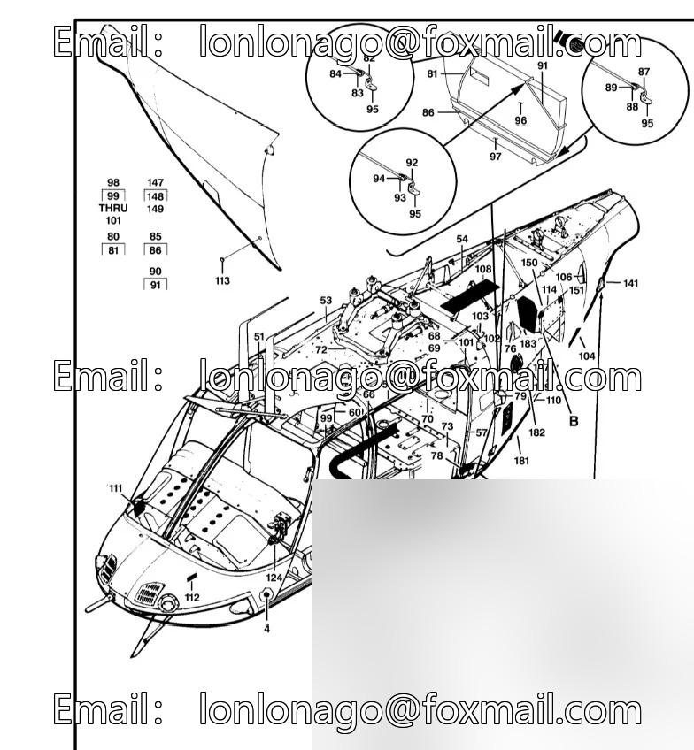
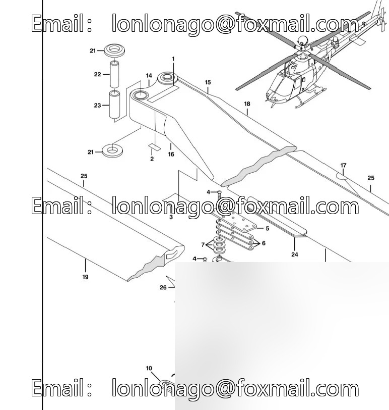
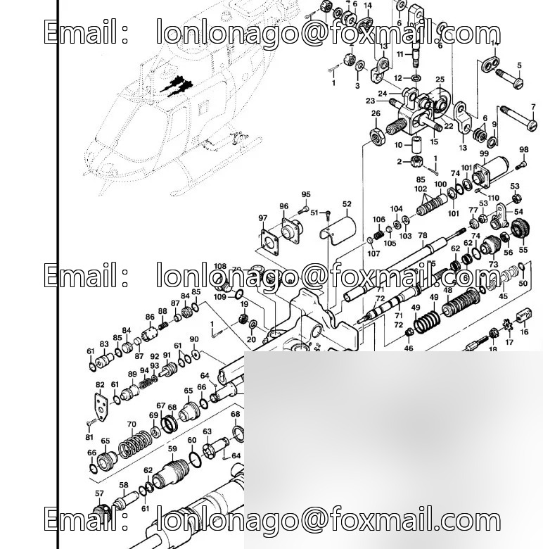

# OH-58D observation helicopter design material

## Body

OH-58D observation helicopter design materials HELICOPTER, OBSERVATION OH-58D (observation helicopter OH-58D, i.e., "Ioowa Warrior" armed reconnaissance helicopter, which is the upgraded model of the earlier OH-58A/C).
224686

PDF file 1300 pages

The material provides design materials for the OH-58D observation helicopter, along with related pages and file information.

<!-- AI_ENRICHED -->

## Images

## Payment

Here is a pay link on Stripe ( https://buy.stripe.com/3cs8yP7sY87d0vu9AB ). Please contact me lonlonago@foxmail.com after funding $89, and I will send you a complete data files , thank you!

